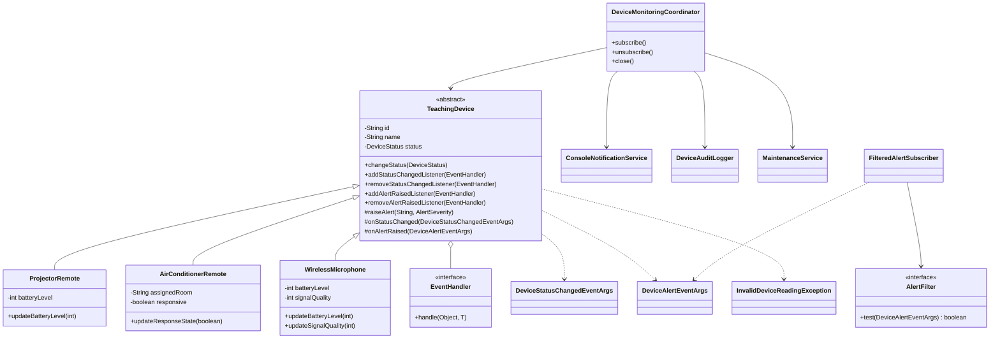

# Thiết kế trước khi cài đặt

## Publisher và subscriber

`TeachingDevice` và ba lớp thiết bị là publisher. Chúng chỉ cập nhật dữ liệu và phát sự kiện,
không biết dịch vụ nào đang lắng nghe. `ConsoleNotificationService`, `DeviceAuditLogger`,
`MaintenanceService` và `FilteredAlertSubscriber` là subscriber. Coordinator nối hai phía.

Java thay `event EventHandler<T>` bằng danh sách listener riêng tư và các phương thức
add/remove công khai. `EventHandler<T>` và `AlertFilter` là functional interface;
`Consumer<DeviceAlertEventArgs>` thay `Action<T>`. `AutoCloseable.close()` thay `Dispose()`.
Chỉ publisher/lớp con gọi được các phương thức phát sự kiện `protected`.

## Dữ liệu và quy tắc

- `StatusChanged`: mã thiết bị, trạng thái cũ/mới, thời điểm thay đổi.
- `AlertRaised`: mã thiết bị, thông điệp, mức độ, thời điểm xảy ra.
- Trạng thái ban đầu: Available; pin/tín hiệu: 100%; điều hòa có phản hồi.
- Pin máy chiếu: 20–100 an toàn, 1–19 Warning, 0 Critical.
- Pin micro: 30–100 an toàn, 1–29 Warning, 0 Critical.
- Tín hiệu micro: 40–100 an toàn, 1–39 Warning, 0 Critical.
- Chỉ cảnh báo khi chuyển vào một vùng lỗi khác; chuyển về vùng an toàn không cảnh báo.
  Quy tắc này áp dụng cả micro để tránh lặp. Từ 0 lên mức thấp khác 0 phát Warning
  vì vẫn cần xử lý dù đã thoát mức Critical. Pin và tín hiệu được theo dõi độc lập.
- Dữ liệu ngoài 0–100 gây `InvalidDeviceReadingException` trước khi thay đổi dữ liệu.
- Trạng thái được cập nhật trước khi gọi listener; không phát khi trạng thái không đổi.
- Phát sự kiện đồng bộ trên bản sao danh sách listener. Các RuntimeException từ listener
  được gom lại và ném sau khi các listener còn lại đã được gọi; dữ liệu đã cập nhật
  không bị hoàn tác. Đây là ứng dụng console một luồng, không cam kết thread safety.
- Coordinator lưu đúng đối tượng handler để hủy đăng ký, không đăng ký trùng;
  close hủy đăng ký và kết thúc vòng đời coordinator.

## Câu hỏi thiết kế

1. Thiết bị không gọi trực tiếp MaintenanceService để tránh phụ thuộc vào cách xử lý
   nghiệp vụ. Có thể thêm email/dashboard bằng subscriber mới mà không sửa thiết bị.
2. Dùng event riêng khi ý nghĩa và dữ liệu khác nhau (đổi trạng thái so với cảnh báo).
   Các cảnh báo pin/tín hiệu dùng chung event vì cùng cấu trúc; subscriber lọc theo severity.
3. Chỉ TeachingDevice và lớp dẫn xuất phát event. Bên ngoài chỉ đăng ký/hủy đăng ký.

## UML

